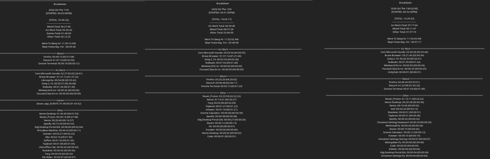

# Log 5  - 11/12/13/14th of october 2026

Spent the last 3 days rebuilding the NFSO website from scratch. learning new tricks. and making it a better experience. 

added a bunch of new features, and made it look like the video games start menu.

also learned some scaling tricks to make it work on 1366x786 laptop screens, and even 800x600 screens if anyone is still using it.

Also started the Wiki website on the side. 

---

The major problem with tracking here is...

its a website. 

Firefox is my default browser. 

So when i start/stop the dev test site. it opens in firefox. 

SO a lot of accumulated hours in firefox was just me testing stuff and working out the kinks.

i would safely assume 50%+ of the firefox time was dev. 
havn't even really played games. :V the partners know. 

been waking up. grinding this website. and passing out. 

fun days. 

