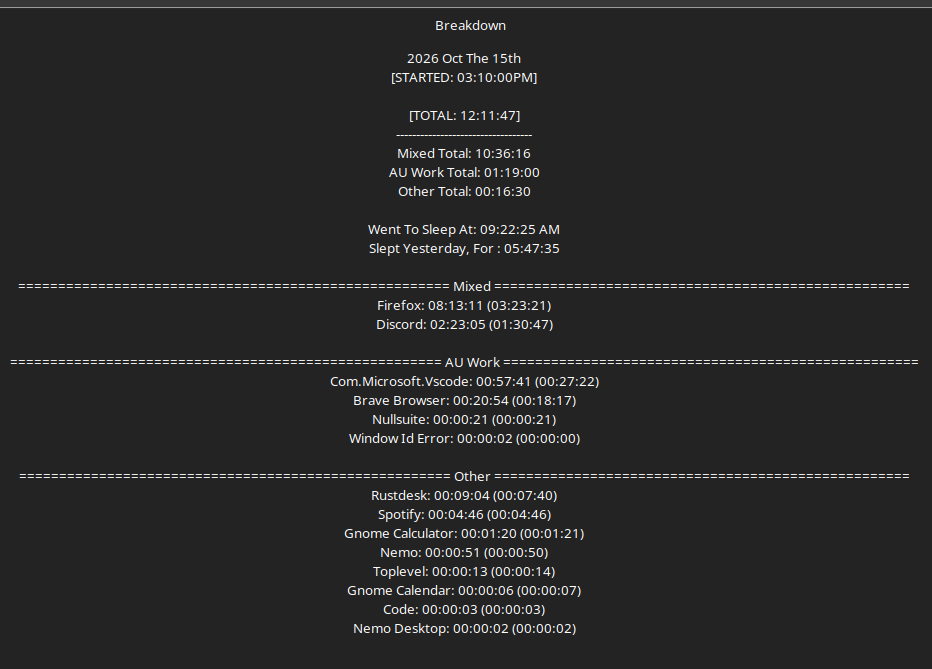

# Log 6  - 15th of october 2026

---

THIS IS SUPPOSED TO BE AN EASY BREAK MONTH. buuuuuuut. lets i saw a thing. thought it was stupid. it led to a million branch thought. and well... 
here we go. 

this was about 2 + hours of system designing in my head. 

and then i explained it all to ChatGPt for spots i might miss just incase. 

but none were found. 

thankfully. i can now have it summerize everything 🙃
yeah. 

all that shit below? THATS A SUMMARY

we go deep.
its only been 4 hours of work at this point.............yayyyyyy :D

---

Mana Veins, Trauma, Healing, and Critical Hit Rework

Overview

A significant rework of AoA's health, healing, and critical-hit systems was developed to better align gameplay mechanics with the established laws of Mana.

The primary goal is to give HP, injury, healing, and critical damage concrete meanings within Ardron's universe while maintaining practical, enjoyable tabletop gameplay.

Rather than introducing arbitrary exceptions, the new mechanics build upon existing Mana physics and biological principles.

1. HP and Physical Health

HP represents a living being's physical health.

Although HP is expressed numerically, it does not correspond directly to a percentage of the body that has been damaged or destroyed.

For example, losing 75% of one's HP does not necessarily mean losing 75% of one's physical body. A character can remain capable of fighting despite severe HP loss.

This is an intentional gameplay abstraction.

The important distinction is that HP has a defined meaning rather than representing an undefined combination of luck, stamina, morale, and physical injury.

HP represents bodily health. Mana Vein trauma represents a separate form of damage.

2. Mana Vein Biology

Living beings possess Mana Veins, which absorb ambient Mana and process it into usable Mana corresponding to the individual.

These veins are not conventional physical tissue, but they possess structure and can be damaged.

Different attacks affect them differently:

Slashing: Can sever Mana Veins.

Piercing: Can puncture or rupture Mana Veins.

Bludgeoning: Can crush or flatten Mana Veins.

Fire and other magical effects: Can injure surrounding bodily tissue without necessarily causing lasting damage to Mana Veins. Particularly severe strikes, such as critical hits, may damage the veins themselves.

Damage to Mana Veins does not necessarily produce proportional bodily damage, and bodily injuries do not necessarily result in lasting Mana Vein damage.

When severed or damaged, Mana Veins attempt to reconnect and redistribute their structure. This can leave them thinner and weakened.

Over time, the veins absorb ambient Mana to restore their original structural integrity.

3. Mana Vein Trauma

Mana Vein Trauma (MV Trauma) is a new mechanic representing lasting structural damage to Mana Veins.

Trauma reduces the amount of HP a character can recover, effectively lowering their recoverable maximum HP.

It is distinct from ordinary HP damage.

A character may have bodily injuries that can be healed but remain unable to recover fully because their Mana Veins have not regenerated.

The effective maximum HP has a floor of 1 HP, even at 100% trauma.

Trauma from Being Downed

When a character reaches 0 HP, they receive trauma equal to 25% of their original maximum HP.

This creates lasting consequences for being downed without requiring every ordinary attack to cause trauma.

At full trauma, ordinary HP healing cannot restore a downed character to fighting condition until some trauma is removed.

The existing Tenacity and Perseverance stabilization mechanics remain relevant.

4. Critical Hit Rework

Previously, critical hits could multiply damage by ×2 or ×3.

This created substantial damage spikes based on random chance.

The new approach replaces these multipliers with additional damage that can be directed toward different consequences.

Critical Damage Allocation

When an attacker inflicts critical damage, they may choose how the additional damage is applied.

Option A — Outward Damage

The additional critical damage is applied directly to the target's HP.

This is useful for quickly defeating enemies, especially those unlikely to heal.

Option B — Inward Trauma

The additional critical damage is applied as Mana Vein trauma.

This reduces the target's ability to recover HP and is particularly useful against enemies with healing or regeneration abilities.

Example

An attack deals 100 ordinary damage and generates 25 additional critical damage.

Outward: 125 HP damage.

Inward: 100 HP damage and 25 MV trauma.

The ordinary attack damage remains unchanged. The attacker chooses the destination of the additional critical damage.

This preserves the offensive usefulness of critical hits without requiring critical damage multipliers.

Why This Works Within the Lore

Mana is controllable by its user.

AoA already establishes that magical attacks can be directed around allies, preventing friendly fire.

Applying similar control to critical damage is consistent with this existing principle.

Rather than creating separate rules for creatures and players, both use the same critical-damage allocation mechanic.

The attacker determines whether the additional damage is directed toward bodily injury or Mana Vein trauma.

Critical Severity

Critical interactions may produce varying levels of trauma severity, with values such as 10%, 25%, and 50% under consideration.

Critical hits may also inflict afflictions, including rare Tier 3 afflictions.

The final critical-hit matrices and severity calculations remain under development.

5. Healing Rework

Healing is being separated into two distinct functions:

Restoring bodily health.

Repairing Mana Vein trauma.

These are related but mechanically different processes.

Healing Kits

Healing kits restore ordinary HP but do not repair Mana Vein trauma.

A proposed Tier 1 healing kit restores:

10d6 HP

Healing Potions

Healing potions restore both ordinary HP and Mana Vein trauma.

A proposed Tier 1 healing potion restores:

5d6 HP + 1d6 MV Trauma

Healing potions restore less immediate HP than equivalent healing kits but provide the additional benefit of repairing Mana Veins.

This makes trauma recovery more valuable and difficult than ordinary HP restoration.

Higher-tier healing items will provide improved effects.

Natural Trauma Recovery

Mana Veins can regenerate naturally through rest.

The existing rest system, including short rests, naps, and long rests, will provide opportunities for trauma recovery.

The exact recovery values will be determined using the established rest mechanics.

Trauma is not intended to introduce additional Mana regeneration or spellcasting penalties. Its principal mechanical consequence is reduced recoverable HP.

6. Mana Colors and Healing

The healing system is being aligned with the established properties of Mana.

Green Mana — Healing

Green Mana is responsible for healing living beings. Water is associated with healing.

White Mana — Vitality

White Mana inflicts vitality damage rather than functioning as conventional healing magic.

Undead beings are especially vulnerable to vitality damage.

Black Mana — Death and Resurrection

Black Mana is associated with death, the Sanctum, and the retrieval of souls.

Resurrection belongs to Black Mana rather than White Mana.

Black Mana damage directly affects Mana Veins and can produce trauma.

These distinctions replace inherited RPG conventions that did not adequately reflect Ardron's cosmology.

7. Necromancers and Undead HP

Necromancers have a special relationship with HP and trauma.

The Necromancer class permanently sacrifices half of the character's original maximum living HP in exchange for an equivalent Undead HP range.

Undead HP is not simply additional maximum HP.

Because trauma reduces recoverable living HP, the Undead HP system creates a distinct interaction with trauma.

Necromancers also have different healing vulnerabilities:

Green healing is harmful to them.

Black Mana can heal them.

White vitality damage is particularly dangerous.

A naturally undead species combined with the Necromancer class can have stacking vulnerabilities because the modifiers originate from separate levels of the Power Chain.

For example, a ×2 undead species vulnerability and ×2 Necromancer class vulnerability produce ×4 vitality damage.

8. Players and Creatures Follow the Same Rules

AoA maintains the principle that players and creatures can perform the same actions and are governed by the same underlying mechanics.

An initial idea was to make player critical hits deal direct bonus damage to creatures while allowing creatures to inflict trauma on players.

This would have introduced an unnecessary asymmetry.

The revised critical-damage allocation system avoids that exception.

Both players and creatures may choose between outward HP damage and inward MV trauma.

This makes the system more consistent while allowing different tactical decisions.

Existing HP Differences

Player characters are chosen by the Fate Weavers.

This grants supernatural power but shortens their lifespan, represented partly through their reduced maximum HP relative to other beings.

Creature HP is typically calculated around:

Player HP × 2 × Party Size

This difference is supported by existing lore and does not require creatures to operate under fundamentally different combat rules.

9. Combat Balance and Randomness

AoA is a dice-based game.

Players cannot reliably avoid every attack, regardless of their build.

Because of this, trauma should not occur with every successful hit.

Instead, it is associated with particularly significant events, such as critical hits and being downed.

This ensures trauma remains consequential without making ordinary combat excessively punishing.

The existing defensive systems remain important:

Evasion: Avoiding attacks.

Defense: Mitigating physical attacks.

Ward: Improving magical defenses.

Impedance: Mitigating magical attacks.

Characters cannot maximize every defensive category simultaneously.

The goal is to reward tactical choices without requiring impossible levels of damage avoidance.

10. Design Philosophy

This rework reinforces several established AoA principles.

Power does not equal invincibility.

Characters may become exceptionally powerful while remaining vulnerable to enemies, damage types, and circumstances that counter their strengths.

Players and creatures obey the same fundamental rules.

Rather than introducing arbitrary exceptions to solve balance problems, mechanics should follow the established laws of the universe whenever possible.

Magic has understandable principles.

Mana is not an unrestricted explanation for anything the rules cannot otherwise justify. Its behavior should remain consistent with Ardron's established physics.

Meaningful choices produce meaningful consequences.

Critical damage allocation introduces a tactical choice between immediate damage and lasting injury.

Neither option is universally superior.

Gameplay must remain practical.

AoA does not attempt to simulate every anatomical consequence of injury. Numerical HP remains an abstraction, but its meaning is clearly established.

The goal is not perfect biological realism. It is internal consistency combined with enjoyable gameplay.

Final Principle

Ashes of Arcanum is not a power fantasy. It is a fantasy where you have power.

Players are living beings who have been granted supernatural capabilities, not invincible gods.

Their abilities are powerful, but their choices, vulnerabilities, and limitations remain meaningful.

Development Status

Established design decisions:

HP represents physical health.

Mana Vein trauma is distinct from HP damage.

Trauma reduces recoverable maximum HP.

Critical bonus damage can be allocated to HP or trauma.

Players and creatures use the same allocation rules.

Healing kits and healing potions serve different purposes.

Mana colors follow their established cosmological functions.

Still requiring implementation or final balancing:

Final critical-hit severity calculations.

Final healing item values and tier progression.

Trauma recovery amounts for each rest type.

Critical-hit and affliction interaction tables.

Testing against high-HP creatures, regenerating enemies, and different player builds.

Development note: This rework originated outside a planned AoA development session and evolved into a broader examination of combat, healing, and Mana Vein biology.

---

no extra work happened. i quickly then soon passedout,a nd continued to pass out for days after.... 