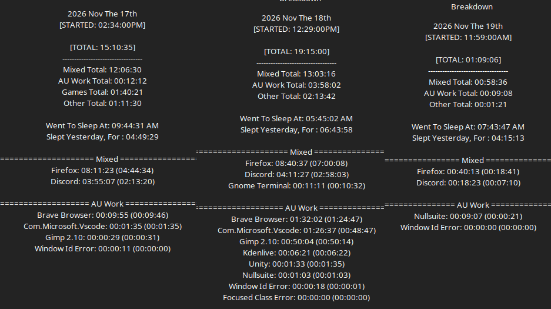

# Work Log 5

currently the 20th, but uh. couldn't hash it out anymore. went to urgent care. 

:D i got bronchitis. need serious antibiotics and an inhaler. yayyyy

...still got SOME work done, fighting shit hard. 

but uh. 

restructured everything to have a unity server isntead of headless. 
cause i have to keep the data base in unity for the char creator and other things. 

soooooooo. got all that settled. 
setup ports and town setups and character setups. 

and the unity server software, and redid the discord git to handle the bots and new server. 
and...........>

I DID A LOT OK. for being basically on my deathbed with this shit. 

eat me. 